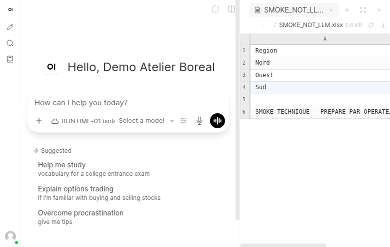
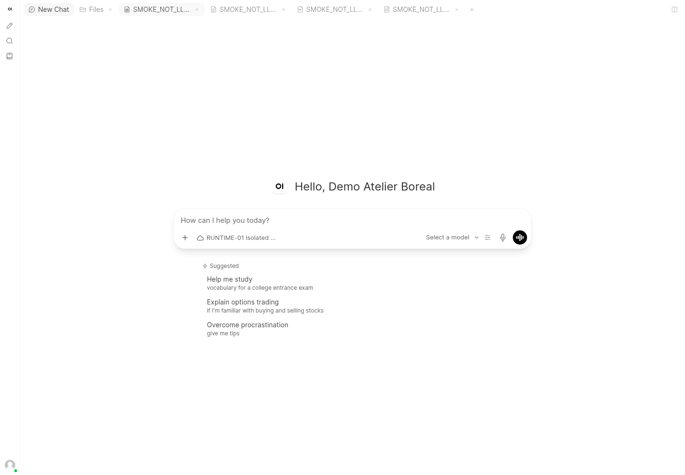
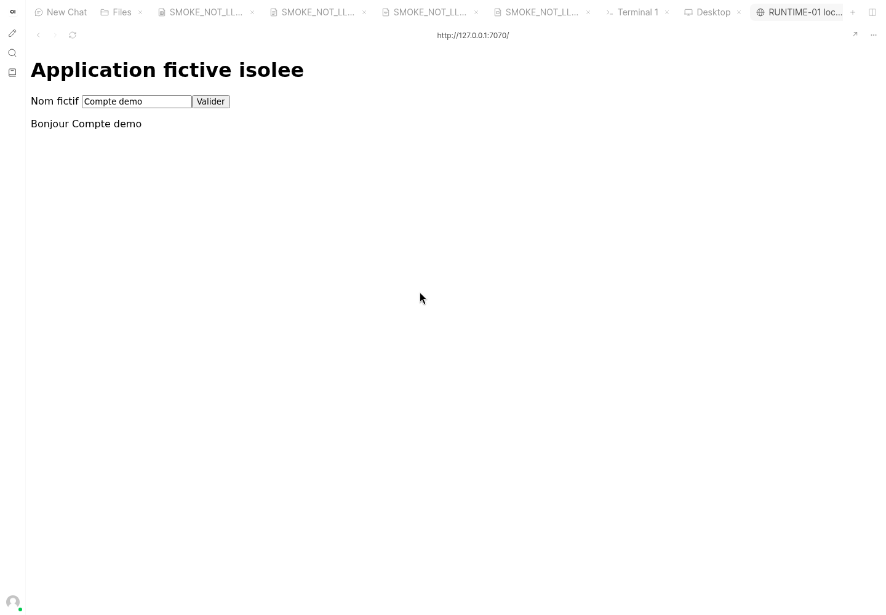
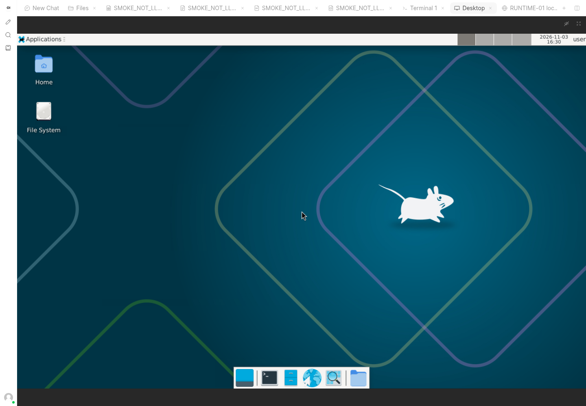
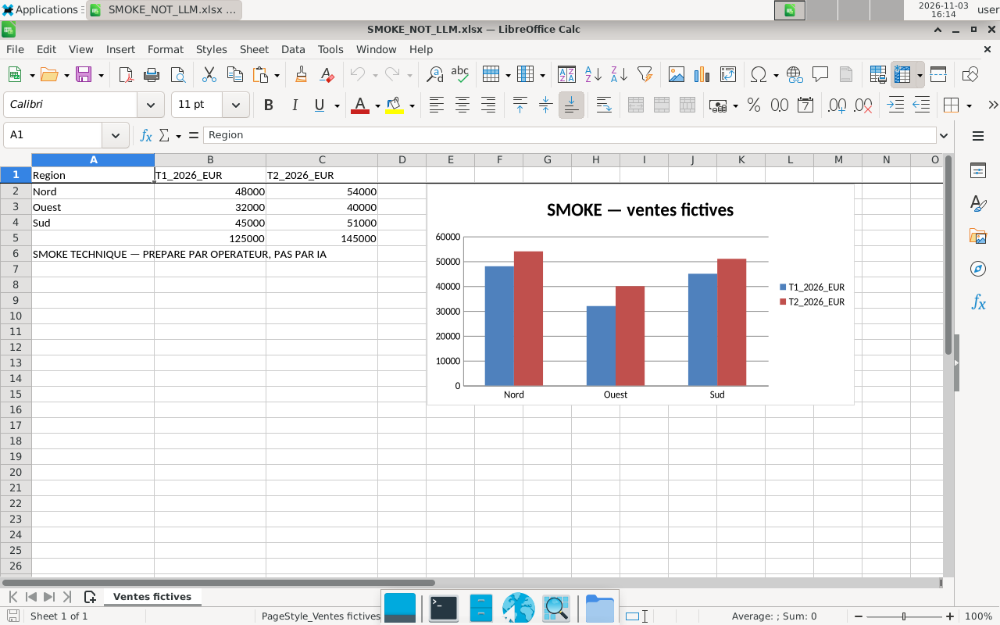

# RUNTIME-01 — Démonstration, contrôles et essais non exécutés

3 novembre 2026, contrôles en UTC. Dépôt documentaire `Pascal440/trinity-docs`, branche `reports/runtime01-lab`, base `reports/launch06-release-candidate` / `5f1f6072bcbd5ca587b18fac84250e497fed8b12`. Aucun dépôt technique publié/modifié. Code Gateway consulté : `f79ff7f4ca938e0610a6e753b4b107dd4edc7437` ; référence Infra inchangée `5bd6fee98a468191613766e0093bdcda8de59099` et Portal LAUNCH-06 `6df4b5a338ac84bd928610292981962eeedd9ee6`. Scripts de laboratoire locaux séparés ; SHA documentaire final fourni dans la PR/livraison.

## État de la démonstration principale

**Aucun essai réel du scénario demandé n’est exécuté avec un LLM.** Le budget externe est 0 €, aucune identité Gateway de démonstration autorisée n’est disponible et WebUI n’a aucun fournisseur modèle actif. Ni remplacement de modèle, ni faux fournisseur, ni faux échange assistant/outils. Les actions et fichiers ci-dessous sont explicitement des contrôles opérateur.

| Essai indépendant | État | Actions terminal LLM | Corrections autonomes | Interventions pendant essai | Exactitude / qualité | Latence / tokens / coût |
| --- | --- | --- | --- | --- | --- | --- |
| 1 | Bloqué, non exécuté | N/A | N/A | N/A | Non évaluées | N/A |
| 2 | Bloqué, non exécuté | N/A | N/A | N/A | Non évaluées | N/A |
| 3 | Bloqué, non exécuté | N/A | N/A | N/A | Non évaluées | N/A |

Zéro succès et zéro échec attribués au modèle ; aucun taux de réussite calculable. La modification ultérieure dans la même conversation est également non exécutée. Les coûts internes TN-27Q ne sont pas estimés à zéro par défaut : ils sont **non mesurés**, puisque aucun appel n’a lieu. Aucun appel d’inférence externe déclenché. [Enregistrement structuré](runtime01-evidence/demo-attempts.json).

## Trois documents professionnels d’entrée entièrement fictifs

Scénario « Atelier Boreal » : `01_ventes_fictives.xlsx`, `02_brief_fictif.docx`, `03_couts_fictifs.pdf`. Les trois originaux sont conservés dans l’espace local séparé et leur [SHA256](runtime01-evidence/inputs-manifest.json) publié. Ils constituent des **entrées préparées**, pas les livrables attendus de l’IA. `read_file` extrait effectivement leurs valeurs et textes. Aucun document client.

| Région fictive | CA T1 2026 (€ HT) | CA T2 2026 (€ HT) |
| --- | --- | --- |
| Nord | 48 000 | 54 000 |
| Ouest | 32 000 | 40 000 |
| Sud | 45 000 | 51 000 |

Le brief fixe un objectif T2 de 150 000 € et une marge d’au moins 35 % ; le PDF source indique des coûts T1 de 79 000 € et T2 de 92 000 €. Le script indépendant relit les **trois fichiers** et obtient : CA 125 000 → 145 000 €, variation +20 000 € / +16 %, marges 46 000 → 53 000 €, marge T2 36,5517 %, écart à l’objectif −5 000 €. [Référence indépendante](runtime01-evidence/independent-reference.json). Ce calcul préalable ne valide aucun résultat de modèle.

## Contrôles techniques réalisés, sans LLM

- Trois lectures documentaires natives et une commande native API réellement exécutées ; commande supplémentaire saisie dans le terminal UI, marqueur de sortie réellement reçu via websocket.
- Quatre fichiers `SMOKE_NOT_LLM.*`, écrits par le script opérateur : classeur avec sommes et graphique, Word, PDF et une diapositive PPTX. Quatre aperçus UI et quatre téléchargements UI réussis ; téléchargements identiques aux originaux (XLSX 6 806 octets, DOCX 36 981, PDF 6 545, PPTX 28 316). [Résultats API](runtime01-evidence/office-checks.json), [UI](runtime01-evidence/ui-office.json), [téléchargements UI](runtime01-evidence/ui-downloads.json).
- Calc ouvre le classeur, recalcule les totaux et affiche le graphique dans le bureau opérateur ; bureau du compte de démo connecté dans WebUI. Chrome partage le contexte provisoire du compte de démo avec les actions natives, formulaire local validé. [Terminal UI](runtime01-evidence/ui-terminal.json), [Browser/Desktop UI](runtime01-evidence/ui-browser-desktop.json).

L’aperçu Excel ne recalcule pas les formules et n’affiche pas le graphique du classeur : les cellules sans cache y restent vides. Ce défaut de restitution est conservé dans les observations ; aucun fichier n’est amélioré manuellement pour être présenté comme une production IA.

## Incidents et interventions de qualification

Un premier chargement Playwright attendait `networkidle`, inadapté aux flux persistants de cette interface ; attente DOM puis éléments effectifs utilisée. Plusieurs sélecteurs du pilote visaient des boutons alors que les rôles sont tab/menuitem/menuitemradio ou un titre de navigateur devenu dynamique : corrigés dans les seuls scripts locaux. Un formulaire HTML de fixture a été corrigé ; les références de navigateur expirées ont été relues. Ces erreurs de harnais ne sont pas comptées comme des défaillances du LLM.

Une action Desktop et des démarrages Chrome ont réellement échoué à la borne de **384 processus**, avec deux contextes et le navigateur auxiliaire exécuté dans le terminal. Fermeture des processus auxiliaires terminés, puis limite du seul terminal portée à **512**, toujours 2 GiB/1 CPU ; les tests Chrome et Desktop UI réussissent ensuite. Aucun OOM observé et aucune augmentation mémoire du VPS. Le navigateur auxiliaire et son relais de débogage sont finalement fermés. Les comptes, grants et fichiers de contrôle ont été préparés par l’opérateur ; aucune de ces interventions ne constitue une correction autonome par IA.

## Protocole prêt pour après arbitrage, non lancé

1. Recevoir l’autorisation explicite de l’identité/route TN-27Q et de ses quotas. Aucun modèle externe payant ni clé GIPS/production implicite. Reconfirmer ressources, bornes de tours d’outils et absence de fallback payant. Désactiver les générations auxiliaires de titre/tags/suivi pour mesurer précisément ce qui est autorisé.
2. Réaliser les trois essais **séquentiellement**, chacun avec un chat neuf et un home Terminal vierge (nouvelle session jetable contrôlée), les mêmes trois entrées originales, aucun accès aux résultats de l’essai précédent. Pas trois laboratoires concurrents sur ce VPS. Exporter les preuves d’un essai avant son arrêt ; aucune donnée D8 réutilisée.
3. Depuis le vrai compte WebUI, sélectionner TN-27Q, le terminal natif et les trois fichiers, puis envoyer : « Analyse ces documents, identifie les informations importantes, crée un tableau Excel de synthèse avec des graphiques et produis un rapport PDF professionnel présentant les conclusions. » Vérifier le rattachement du terminal ouvert avant le premier message.
4. Collecter les traces d’outils, erreurs et reprises sans retoucher les résultats. Télécharger les fichiers depuis leurs vrais onglets, vérifier les octets, formules, graphique, textes, ouverture et mise en page. Comparer aux calculs indépendants ; une éventuelle recalculation de contrôle doit se faire sur une copie, jamais comme correction manuelle de l’original livré.
5. **Dans le même chat et le même workspace de cet essai**, demander : « Ajoute une comparaison entre les périodes, corrige les écarts et produis une version mise à jour des fichiers. » Vérifier conservation des entrées, références et évolution réelle des fichiers ; conserver V1/V2 et leurs empreintes.
6. Relever actions terminal, corrections autonomes et interventions humaines, calculs exacts, qualité/ouverture, latence de bout en bout, tokens Gateway dédiés et coût calculable avec son statut mesuré/estimé/manquant. Un quota atteint arrête l’essai ; pas d’augmentation implicite. Après les trois essais, arbitrer DEMO-01 ; aucune mission suivante automatique.

## Preuves visuelles, exclusivement contrôles opérateur

